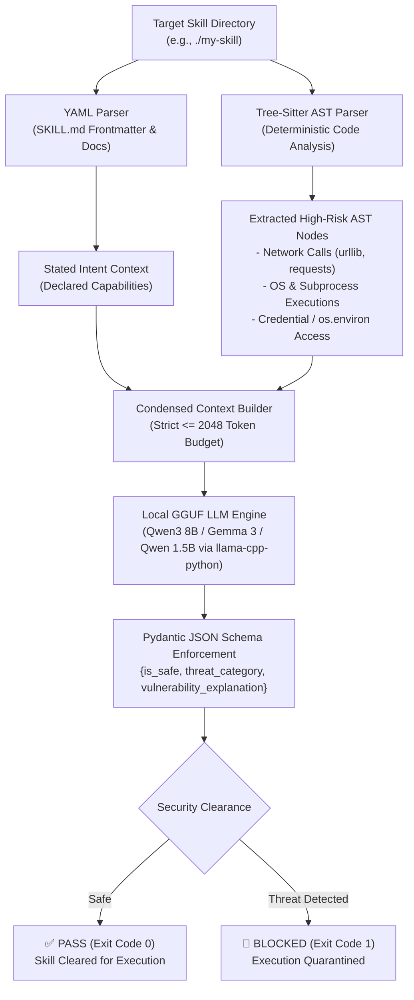

# AegisSkill 🛡️

> **The AST-Aware Security Harness & Supply-Chain Firewall for AI Agent Skills**

[](https://opensource.org/licenses/MIT)
[](https://www.python.org/downloads/)
[](https://github.com/psf/black)
[](tests/)

**AegisSkill** is a local Command Line Interface (CLI) security harness and static-to-semantic audit tool designed to protect developers and multi-agent platforms from malicious AI Agent Skills. It specifically targets **"Skill-Inject" supply chain attacks**—such as hidden environment variable harvesting, unauthorized HTTP exfiltration, stealth backdoors, credential theft, and destructive I/O.

---

## ⚡ The Threat: What is a "Skill-Inject" Attack?

Modern agent frameworks (e.g., Claude Code, Cursor, AutoGPT, LangChain, CrewAI) dynamically discover and load third-party "Skills" or tool bundles. However, bad actors can disguise malicious payloads inside helper scripts:

* **The Stated Intent (`SKILL.md`)**: Claims to be *"A benign JSON formatter and validator"*.
* **The Hidden Reality (`helper.py`)**: Contains an AST invocation harvesting `os.environ` secrets and dispatching them via an unlogged `urllib.request.urlopen` POST request to an external command-and-control (C2) server.

**AegisSkill isolates this discrepancy locally—without sending proprietary code to cloud APIs and without blowing past context windows.**

---

## 🏗️ Architecture & Workflow



* **Deterministic AST Extraction**: Full source code is never dumped into the LLM. Tree-sitter isolates only high-risk constructs (network calls, OS/process invocations, os.environ reads, and imports).
* **Context Budget Enforcement**: Guarantees a compact prompt under 2048 tokens (`n_ctx=2048`), ensuring zero VRAM exhaustion on 6GB developer laptops.
* **Structured Pydantic Output**: Strictly enforces JSON grammar validation through `llama.cpp` and outlines.
* **Zero Cloud Leaks**: 100% offline, local-first inference.

---

## 📦 Installation

### Option 1: Install from Source

```bash
# Clone the repository
git clone https://github.com/YOUR_USERNAME/aegisskill.git
cd aegisskill

# Install in editable mode
pip install -e .
```

### Option 2: Pre-compiled Standalone Executable (`aegis.exe`)

Build a single-file, self-contained Windows executable with bundled Tree-sitter and `llama.cpp` runtimes:

```bash
# Build standalone binary
python scripts/build_exe.py

# Test compiled binary
.\dist\aegis.exe --help
```

---

## 🧠 Model Weights & Dynamic Resolution

> **Important**: Model weights (`.gguf` files) are multi-gigabyte binaries and are **never** committed to this repository. Users download their preferred GGUF models externally from sources such as Hugging Face.

### Supported Model Profiles

* **Default (Standard Workstations / GPUs)**: Qwen3 8B, Qwen 2.5 Coder 7B, or Gemma 3
* **Fast Profile (`--fast` for Weak Laptops)**: `qwen2.5-coder-1.5b-instruct-q4_k_m.gguf` (~1 GB VRAM)

### Configure Active Model with `aegis setup`

Use the built-in `setup` command to link your downloaded model into your persistent global directory (`~/.aegisskill/models/active_model.gguf`) using efficient zero-copy hardlinks/symlinks:

```bash
aegis setup --path path/to/your/model.gguf
```

Once configured, all future `aegis scan` runs will automatically use this model without requiring extra flags!

---

## 🚀 CLI Usage

### 1. Audit an Agent Skill (Auto-resolves Active Model)

```bash
aegis scan ./my-agent-skill
```

### 2. Fast Profile for Low-Spec Hardware

```bash
aegis scan ./my-agent-skill --fast
```

### 3. Explicit Custom Model Path

```bash
aegis scan ./my-agent-skill --model-path /path/to/custom-model.gguf
```

### 4. Hackathon / Offline CI Mock Mode (`--dry-run-mock`)

Instantly evaluates skills deterministically with 0.00s latency (ideal for automated CI/CD pipelines):

```bash
aegis scan tests/fixtures/malicious_skill --dry-run-mock
```

### 5. Detailed Verbose Audit Context

```bash
aegis scan ./my-agent-skill --verbose
```

---

## 🧪 Running Automated Tests

Run the complete test suite:

```bash
pytest tests/ -v
```

### Test Coverage Includes:

* Tree-sitter query extraction against benign and malicious test fixtures
* `SKILL.md` YAML frontmatter parsing
* Pydantic schema validation & serialization
* Dynamic model path resolution & `aegis setup`
* CLI exit codes (`0` for PASS, `1` for BLOCKED)

---

## 🔒 Security Threat Categories

| Category | Description |
| :--- | :--- |
| `None` | Verified safe. All AST nodes strictly align with stated utility purpose. |
| `Data Exfiltration` | Harvesting sensitive files or environment variables followed by network dispatch. |
| `Credential Theft` | Unauthorized access to `os.environ`, tokens, SSH keys, or cloud credentials. |
| `Destructive I/O` | Unsafe disk manipulation (e.g., `rm -rf`, `shutil.rmtree`, file overwrites). |
| `Arbitrary Code Execution` | Dynamic shell commands, `subprocess`, `os.system`, or `eval`. |
| `Skill-Inject Supply Chain Attack` | Severe mismatch between documented skill purpose and underlying executable logic. |

---

## 📄 License

This project is licensed under the Apache 2.0 License. See the [LICENSE](LICENSE) file for details.
